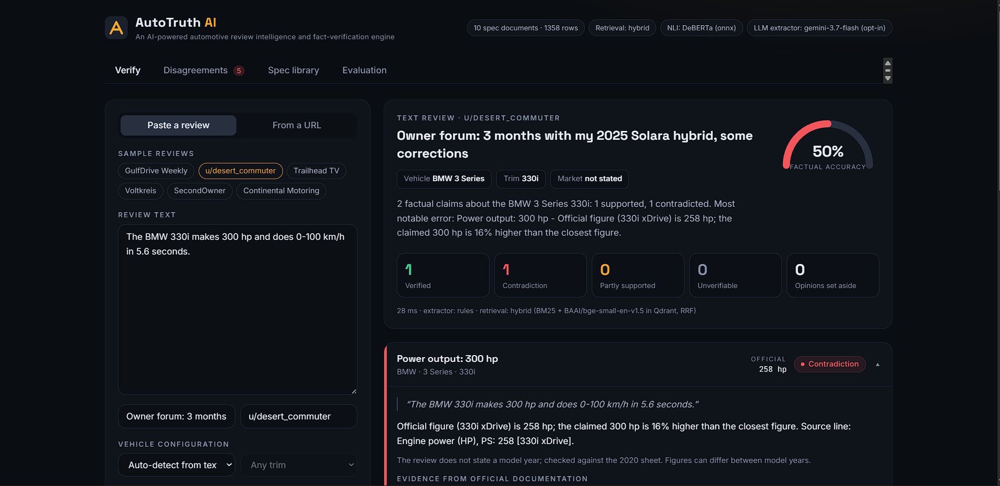
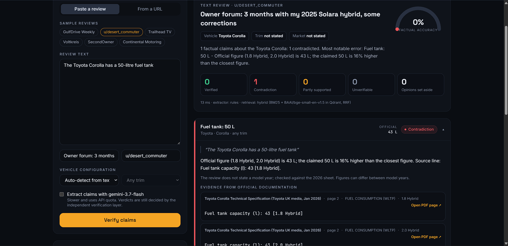
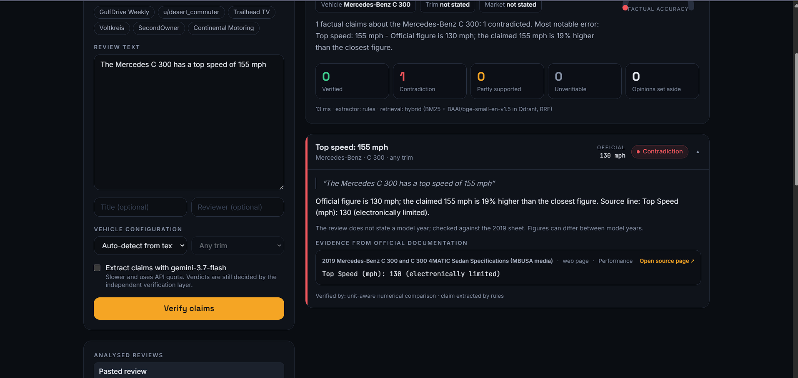
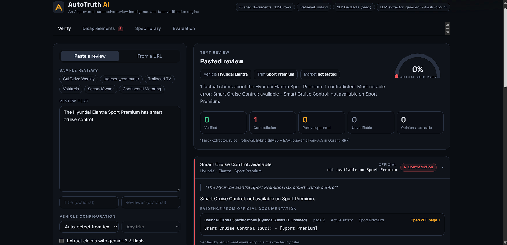

# 🚗 AutoTruth AI

**An AI-powered automotive review intelligence and fact-verification engine.**

Car reviews are full of numbers. Some of them are wrong. 🔍 AutoTruth AI does not summarise what a reviewer says: it breaks the review into individual factual claims, matches each one to the right model year, market and trim, and checks it against the **manufacturer's own specification document**, citing the page and the exact line.

> 🗣️ *"The BMW 330i makes 300 hp and does 0-100 km/h in 5.6 seconds."*
>
> ❌ **Power output: 300 hp** → Contradiction. Official figure is 258 PS (BMW 2020 product guide, p.3)
> ✅ **0-100 km/h: 5.6 s** → Verified

## 📸 Screenshots

| | |
|---|---|
| **BMW 330i**: one claim verified, one contradicted | **Toyota Corolla**: "50-litre tank" against the official 43 L |
|  |  |
| **Mercedes-Benz C 300**: top speed claim against the official 130 mph | **Hyundai Elantra**: equipment checked per grade |
|  |  |

More in [docs/screenshots](docs/screenshots): cross-review disagreements, the specification library and the evaluation tab.

## ✨ Highlights

- 🧩 **Claim decomposition**: one sentence becomes several checkable claims; opinions are set aside, not judged
- 🎯 **Configuration matching**: the right model year, market and trim, or the verdict says it could not match
- 📚 **Specification RAG**: hybrid retrieval (BM25 + BGE embeddings in Qdrant) over official PDFs and web pages
- ⚖️ **Independent verification**: no LLM decides a verdict; unit-aware maths, category matching and a DeBERTa NLI model do
- 📌 **Exact citations**: document, page, section and the verbatim line for every verdict
- 🥊 **Disagreement detection**: finds where two reviewers contradict each other and which one the manufacturer backs
- 🚙 **Six real cars included**: Toyota Corolla, Toyota Camry, Hyundai Elantra, BMW 3 Series, Mercedes-Benz C 300, Nissan Altima
- 💻 **Runs offline**: no API key needed; an LLM extractor is optional

## 🛠️ What it does

| Capability | How |
|---|---|
| Claim decomposition | One sentence becomes several atomic claims (attribute, value, unit, qualifier, trim). Rule-based extractor offline, or any OpenAI-compatible LLM. |
| Subjective vs factual | "The ride is plush" is set aside and never given a verdict. |
| Configuration matching | Claims resolve to (model year, market, trim). A wrong model year is *unverifiable*, not checked against the wrong sheet. A claim that is true for one trim and false for another is *partially supported*. |
| Specification RAG | PDFs are parsed into sections and rows. Retrieval is hybrid: BM25 plus BGE embeddings in Qdrant, fused with reciprocal rank fusion. |
| Independent verification | No LLM decides a verdict. Numbers are compared with unit conversion (hp/PS/kW, km/l, L/100km, mpg, Nm/lb-ft ...) and rounding-aware tolerances; categories and equipment availability are matched; free text goes to a DeBERTa NLI model. |
| Exact citations | Every verdict carries document, page, section heading, trim, the verbatim line, and the measurement standard (NEDC, WLTP ...) when the document names one. |
| Disagreement detection | Across analysed reviews of the same vehicle, conflicting factual claims are paired up and resolved against the official figure. |
| Sources | Pasted text, YouTube transcripts, Reddit threads, article pages. |

## 🏗️ Architecture

```
review text / URL
      │
      ▼
claims.py        sentence split → quantities + units → attribute by nearest keyword → trim / market context
      │           (or LLM extractor; every claim must quote the review verbatim or it is dropped)
      ▼
specs.py         match_configs(): make/model → year → market → trim   →   list of (document, trim)
      │
      ▼
retrieval.py     BM25 + BGE (fastembed) in Qdrant, RRF, filtered to the matched configuration
      │
      ▼
verify.py        numeric comparison │ category match │ feature availability │ NLI (nli.py, ONNX DeBERTa)
      │
      ▼
pipeline.py      verdicts + evidence + summary;  disagreements() across saved analyses
      │
      ▼
api.py (FastAPI) ──► frontend/ (React + Tailwind dashboard)
```

## 🚀 Run it

```bash
python -m venv .venv
.venv/Scripts/python -m pip install -r requirements.txt     # Linux/macOS: .venv/bin/python
.venv/Scripts/python scripts/make_demo_specs.py             # writes the demo PDFs to data/specs/
.venv/Scripts/python scripts/fetch_real_specs.py            # optional: downloads the six real manufacturer sheets
cd frontend && npm install && npm run build && cd ..
.venv/Scripts/python -m uvicorn autotruth.api:app --app-dir backend --port 8010
```

Open http://localhost:8010. The first start downloads two models from Hugging Face (BGE-small embeddings and the DeBERTa NLI cross-encoder, a few hundred MB together). If they cannot be downloaded, retrieval falls back to BM25 and free-text claims are reported as unverifiable; the header shows which mode is running.

For frontend development run `npm run dev` in `frontend/` with the backend on port 8000.

### 🤖 Using an LLM for claim extraction

Copy `.env.example` to `.env` and set `LLM_API_KEY` (plus `LLM_BASE_URL` for Ollama or Gemini). A checkbox then appears in the Verify panel to extract claims with the LLM for that review; the offline extractor stays the default. The LLM only extracts claims. It never decides whether a claim is true.

### 🚙 Real cars

Six real manufacturer sheets are configured next to the fictional demo vehicles. The documents themselves belong to their manufacturers and are not stored in this repository; `python scripts/fetch_real_specs.py` downloads them from the sources recorded in `data/specs/*.meta.json`:

| Vehicle | Official source | Format | Rows parsed |
|---|---|---|---|
| Toyota Corolla (UK, Jan 2026) | media.toyota.co.uk technical specification | PDF | 64 |
| Toyota Camry Hybrid (UK, 2021) | media.toyota.co.uk technical specification | PDF | 20 |
| Hyundai Elantra (Australia, undated) | hyundai.com/au specification sheet, with the equipment grid by grade | PDF | 506 |
| BMW 3 Series Sedan (Canada, 2020) | newsroom.bmwgroup.com 2020MY product guide | PDF | 154 |
| Mercedes-Benz C 300 (US, 2019) | media.mbusa.com specifications | web page | 22 |
| Nissan Altima (US, 2024) | usa.nissannews.com specifications | web page | 366 |

Real sheets are laid out as column tables, which the parser handles as a second mode, for PDFs and for web pages of HTML tables alike:

- **Units in the label, three ways**: `Max. engine power (bhp/DIN hp/kW @ rpm) | 97/98/72 @ 5,200` (Toyota), `Engine power (HP), PS | 258` (BMW), or in the section title, `Exterior Dimensions (in)` over `Wheelbase | 111.8` (Mercedes).
- **Variants as columns**, sometimes two levels deep: `2.0 MPi | 1.6 T-GDi` over `Manual | Automatic | Manual | DCT`.
- **Several variants in one cell**: `188 @ 6,000 RPM – FWD 182 @ 6,000 RPM – AWD`, `23 / 34 / 27 (4MATIC: 22 / 33 / 26)`.
- **Ranges and alternatives**: `Kerb weight (kg) | 1,345 – 1,410`, `Top speed, km/h | 210/250`.
- **Equipment grids**: `Smart Cruise Control | ○ | ○ | - | -` per grade.

A claim is then checked per variant: "0-62 mph in 7.4 seconds" comes back *partially supported* on the Corolla sheet because it holds for the 2.0 Hybrid hatchback and not the estate. UK sheets are read in imperial mpg, and a figure in "hp" is accepted against either bhp or metric horsepower. In a comparison review, a sentence that names another car on file is checked against that car's sheet.

Where a sheet leaves a unit unstated, the sidecar declares it (`"default_units": {"torque": "lb-ft"}` for the Mercedes page) rather than the code guessing. Model nicknames reviewers use go in `"aliases"` (`"330i"`, `"C-Class"`).

`scripts/seed_real_cars.py` posts test claims for these six cars (written for this project, some deliberately wrong) and can fetch real review URLs. To add another car, use the Spec library tab for a PDF, or drop a PDF or saved HTML page in `data/specs/` with a sidecar `name.meta.json` (`make`, `model`, `year`, `market`, `source_url`).

**What a real review showed.** Running a published 2019 road test of the Corolla against the 2026 sheet produced about 20 "contradictions". Most are not reviewer errors: the car's figures changed between model years (180 hp then, 176 bhp now), the review never states its model year, and the offline extractor mislabelled several figures in dense prose ("L 4,650 mm, W 1,790 mm" all read as wheelbase). Treat real-review output from the offline extractor as a draft to inspect, and match the sheet to the review's model year.

`MODEL_YEAR_TOLERANCE` in `.env` controls this: `0` makes a review of an undocumented model year unverifiable; `N` falls back to the nearest sheet within N years and says so on each verdict.

## 📊 Evaluation

```bash
.venv/Scripts/python eval/run_eval.py --ablation
.venv/Scripts/python -m pytest backend/tests -o pythonpath=backend
```

`eval/benchmark.json` holds 89 hand-labelled claims over six sample reviews of the fictional vehicles. Latest run (rule-based extractor, no LLM):

| Metric | Hybrid retrieval | BM25 only |
|---|---|---|
| Claim extraction precision / recall / F1 | 1.000 / 0.989 / 0.994 | same |
| Verification accuracy, end to end | 0.989 | 0.989 |
| Contradiction detection precision / recall / F1 | 1.000 / 1.000 / 1.000 | same |
| Numeric specification matching accuracy | 1.000 | 1.000 |
| Evidence retrieval Recall@1 / @2 / @3 | 0.966 / 0.989 / 1.000 | same |
| Citation correctness (right section and trim) | 1.000 | 1.000 |
| Citations found verbatim on the cited PDF page | 1.000 | 1.000 |
| Spurious claims / fabricated citations | 0 / 0 | 0 / 0 |
| Mean latency per review | ~160 ms | ~6 ms |
| API cost per review | $0 | $0 |

The one miss is "sent to the front wheels" (drivetrain phrased without "front-wheel drive").

**How much to trust these numbers.** Not much beyond "the pipeline works end to end". The benchmark is small, the vehicles are fictional, the demo PDFs share one clean layout, and the extraction rules and the benchmark were written by the same author, so the rules fit these reviews far better than unseen ones. The real-review run above is the more honest picture. A credible evaluation needs real brochures, reviews the rules have never seen, and labels from someone else.

### With an LLM (gemini-3.6-flash)

Run with `eval/run_eval.py --ablation --llm --baseline`. These two LLM runs were made before the later extractor fixes, so compare them with the rule-based column of that same run:

| | Rule-based pipeline (same run) | Pipeline, LLM claim extraction | Baseline: retrieve, then LLM judges |
|---|---|---|---|
| Claim extraction precision / recall | 1.000 / 0.978 | 0.957 / 0.989 | given the gold claims |
| Verification accuracy, end to end | 0.978 | 0.978 | 0.955 |
| Contradiction detection precision / recall | 1.000 / 0.909 | 1.000 / 0.909 | 0.786 / 1.000 |
| Citations verbatim on the cited page | 1.000 | 1.000 | no citations |
| Mean latency per review | ~0.13 s | ~18.5 s | one call per review |

What the baseline got wrong (4 of 89), all cases the independent layer handles by construction:

- "about 1,650 kg" against an official 1,640 kg: called a contradiction (no tolerance for "about").
- "roughly 49 mpg" against an official 4.8 L/100 km: called unverifiable (no unit conversion).
- Two equipment claims that are *partially* true (optional rather than standard): called contradictions.

So the baseline flags every real contradiction but adds three false ones (precision 0.786 against 1.000). The comparison is tilted in the baseline's favour, because it is handed the 89 gold claims while the pipeline has to extract its own. It is still only a 2-claim difference in accuracy on a small benchmark; treat it as an illustration of the failure modes, not a measured effect size.

What the LLM extractor changed in that run: it recovered one claim the rules missed, but produced four claims the benchmark counts as spurious (two are arguably fair) and it read "towing is limited to 2,500 kg" as "less than 2,500 kg", which turned a contradiction into a pass. That last error is fixed: the qualifier is now read from the sentence itself rather than taken from the model, and one live call on gemini-3.7-flash confirmed the claim comes out as exact. A full re-run of the LLM benchmark after the fix did not complete, because the free-tier key was rate-limited.

### Not yet run

- The post-fix LLM benchmark (see above).
- RAGAS is not wired in; the metrics above are computed directly at claim level.
- API cost per review was not measured (the runs used a free-tier key; the baseline used about 39,000 tokens for all six reviews).

## ⚠️ Known limits

- Layouts supported: "label: value" rows under headings (the demo sheets) and column tables with a consistent label column, as PDF or HTML (Toyota UK, Hyundai Australia, BMW Canada, Mercedes-Benz USA, Nissan USA). Other brochure designs and scanned PDFs needing OCR are not handled, and each new manufacturer layout has needed some parser work.
- Parsing is imperfect on the real sheets: the Nissan page's 2.0 VC-Turbo horsepower row has no label and is skipped, BMW's option and wheel pages are ignored, and the Nissan page itself lists one kerb weight as "33442" pounds, which is reproduced as published.
- In column tables, a value centred across several columns, or a label that sits beside the middle line of a wrapped cell, can be attached to the wrong variant. Check the cited line.
- The rule-based extractor only knows the attributes in `ontology.py` and misreads dense real-world prose. The LLM extractor is the intended path for that text.
- A review that does not state its model year is checked against whatever sheet is on file, with a note saying so.
- Bare `mpg` is read as US gallons unless the matched sheet is a UK one.
- Storage is SQLite, not PostgreSQL; there is no Docker image yet.
- URL fetching worked for one article site and was refused by another; YouTube and Reddit fetching are untested.

## 🧰 Tech stack

Python · FastAPI · PyMuPDF · fastembed (BGE) · Qdrant · ONNX Runtime (DeBERTa NLI) · SQLite · React · Tailwind CSS · Vite

## 📄 A note on the data

The Meridian, Kestrel and Voltaire vehicles are fictional and exist only as demo data. The real manufacturer documents are not redistributed here; `scripts/fetch_real_specs.py` downloads them from the official sources. This is a personal project and is not affiliated with any manufacturer.
